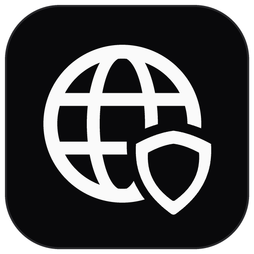

<div align="center">

# Huyvu2512 Block Ads

**DNS mã hóa (DoH) chạy trên Cloudflare Zero Trust Gateway — chặn quảng cáo, tracker & vượt chặn DNS đa nền tảng**

[Tiếng Việt](README.md) · [English](README_EN.md)

[](https://one.dash.cloudflare.com/)
[](https://developer.mozilla.org/)
[](https://blockads.huyvu2512.io.vn/)
[](./SECURITY.md)
[](./LICENSE)

[](https://github.com/huyvu2512/block-ads/stargazers)
[](https://github.com/huyvu2512/block-ads/forks)
[](https://github.com/huyvu2512/block-ads/issues)
[](https://github.com/huyvu2512/block-ads/commits/main)


[Live Website](https://blockads.huyvu2512.io.vn/) · [Tải Hồ Sơ iOS](https://blockads.huyvu2512.io.vn/download) · [Báo Lỗi](https://github.com/huyvu2512/block-ads/issues) · [Yêu Cầu Tính Năng](https://github.com/huyvu2512/block-ads/issues)

</div>

---

<div align="center">
  
</div>

---

## Giới thiệu

**Huyvu2512 Block Ads** là hệ thống DNS mã hóa (**DNS-over-HTTPS**) cá nhân vận hành trên nền tảng **Cloudflare Zero Trust Gateway**, kèm trang web giới thiệu và phân phối hồ sơ cấu hình nhanh cho iOS, macOS, Windows, Android và các trình duyệt hiện đại.

Dự án được xây dựng bởi Huy Vũ ([@huyvu2512](https://huyvu2512.io.vn/)) với mục tiêu lọc quảng cáo, trình theo dõi (tracker), tên miền độc hại và vượt chặn DNS nhà mạng mà **không cần cài ứng dụng nền, không tốn pin và không cài chứng chỉ Root CA**.

---

## Tính năng chính

- **Đa tầng lọc thông minh & gọn sạch** — Kết hợp bộ lọc bảo mật & quảng cáo của Cloudflare (14 nhóm mã độc, lừa đảo), danh sách miễn trừ `Custom-Allow` ưu tiên #1, `Custom-Adblock` chọn lọc từ log thực tế và Regex tự động quét tên miền con quảng cáo.
- **Không cài Root CA — An toàn tuyệt đối** — Hồ sơ `.mobileconfig` chỉ sử dụng `com.apple.dnsSettings.managed`, không thực hiện giải mã HTTPS (MITM), giữ nguyên toàn vẹn kết nối ngân hàng và dữ liệu cá nhân.
- **Tốc độ thấp độ trễ tại Việt Nam** — Tận dụng mạng Anycast của Cloudflare (node Hà Nội / TP.HCM) cho cả Wi-Fi lẫn 4G/5G.
- **Cập nhật tức thì từ Cloud** — Mọi thay đổi rule chặn hoặc whitelist đều áp dụng trực tiếp trên máy chủ Cloudflare mà không cần tải lại hồ sơ trên thiết bị.
- **Giao diện web tối giản (Swiss-grid)** — Hỗ trợ chế độ Sáng/Tối, song ngữ Tiếng Việt / English, bảng mô phỏng DNS Query Inspector và đường dẫn tải nhanh `/download`.

---

## Hướng dẫn sử dụng nhanh

- **iPhone / iPad / macOS:** Mở [blockads.huyvu2512.io.vn/download](https://blockads.huyvu2512.io.vn/download) bằng Safari -> Cho phép tải hồ sơ -> vào **Cài đặt > Đã tải về hồ sơ > Cài đặt**.
- **Windows / Chrome / Edge / Shadowrocket:** Dùng trực tiếp DoH Endpoint:
  ```text
  https://7a64n0vzr5.cloudflare-gateway.com/dns-query
  ```

---

## Cấu trúc dự án

```text
block-ads/
├── assets/
│   ├── logo.png                  # Logo chính (favicon, og:image)
│   └── logo-transparent.png      # Logo nền trong suốt (tự đảo màu Sáng/Tối)
├── profiles/
│   └── huyvu2512.mobileconfig    # Hồ sơ DNS DoH cho iOS/macOS
├── src/
│   ├── style.css                 # Giao diện Swiss-grid (Light/Dark, Responsive)
│   └── script.js                 # Theme toggle, i18n (VI/EN), DNS Inspector
├── index.html                    # Trang chủ
├── vercel.json                   # Rewrite /download & header .mobileconfig
├── SECURITY.md                   # Chính sách bảo mật
├── LICENSE                       # Giấy phép MIT
└── README.md
```

---

## Bảo mật & Giấy phép

- Xem chính sách bảo mật và kiến trúc không-Root-CA tại [SECURITY.md](SECURITY.md).
- Dự án được phát hành theo giấy phép [MIT License](LICENSE).
