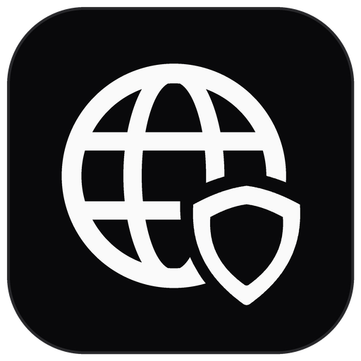

<div align="center">

# Huyvu2512 Block Ads

**Encrypted DNS (DoH) for cross-platform ad, tracker & ISP block bypass**

[Tiếng Việt](README.md) · [English](README_EN.md)

[](https://one.dash.cloudflare.com/)
[](https://developer.mozilla.org/)
[](https://blockads.huyvu2512.io.vn/)
[](./SECURITY.md)
[](./LICENSE)

[](https://github.com/huyvu2512/block-ads/stargazers)
[](https://github.com/huyvu2512/block-ads/forks)
[](https://github.com/huyvu2512/block-ads/issues)
[](https://github.com/huyvu2512/block-ads/commits/main)


[Live Website](https://blockads.huyvu2512.io.vn/) · [Download iOS Profile](https://blockads.huyvu2512.io.vn/download) · [Report Bug](https://github.com/huyvu2512/block-ads/issues) · [Request Feature](https://github.com/huyvu2512/block-ads/issues)

</div>

---

<div align="center">
  
</div>

---

## Overview

**Huyvu2512 Block Ads** is a personal encrypted **DNS-over-HTTPS (DoH)** setup running on **Cloudflare Zero Trust Gateway**, paired with a lightweight landing page and one-click `.mobileconfig` profile distribution for iOS, macOS, Windows, Android, and modern browsers.

Built by Huy Vu ([@huyvu2512](https://huyvu2512.io.vn/)) to block ads, trackers, and malicious domains while bypassing ISP DNS blocks — with **zero background apps, zero battery drain, and zero Root CA certificates**.

---

## Key Features

- **Clean Multi-Layer Filtering** — Combines Cloudflare Security & Ads (14 threat categories), priority #1 `Custom-Allow` whitelist, log-curated `Custom-Adblock`, and regex rules for ad/telemetry subdomains.
- **No Root CA — End-to-End Safe** — The `.mobileconfig` profile only configures `com.apple.dnsSettings.managed` with no HTTPS interception (MITM), keeping banking apps and personal traffic untouched.
- **Low-Latency Edge in Vietnam** — Powered by Cloudflare Anycast (Hanoi & Ho Chi Minh City nodes) across both Wi-Fi and cellular networks.
- **Instant Cloud Updates** — Blocklist and whitelist changes apply immediately on Cloudflare without reinstalling the device profile.
- **Minimalist Web UI** — Swiss-grid Light/Dark theme toggle, bilingual VI/EN switch, interactive DNS Query Inspector, and `/download` shortcut.

---

## Quick Setup

- **iPhone / iPad / macOS:** Open [blockads.huyvu2512.io.vn/download](https://blockads.huyvu2512.io.vn/download) in Safari -> Allow profile download -> **Settings > Profile Downloaded > Install**.
- **Windows / Chrome / Edge / Shadowrocket:** Use the DoH endpoint directly:
  ```text
  https://7a64n0vzr5.cloudflare-gateway.com/dns-query
  ```

---

## Security & License

- See [SECURITY.md](SECURITY.md) for our no-Root-CA security model and vulnerability reporting.
- Released under the [MIT License](LICENSE).
